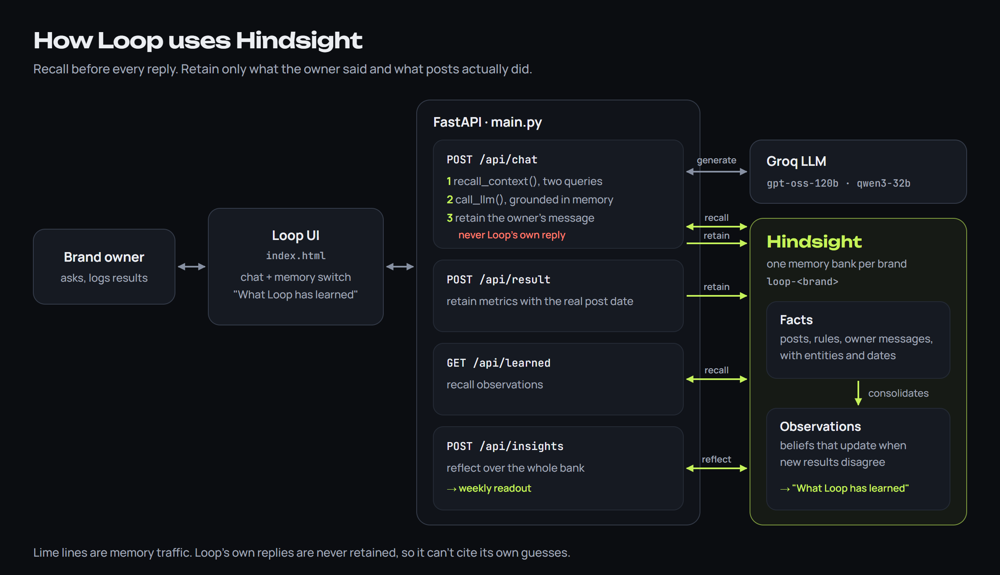
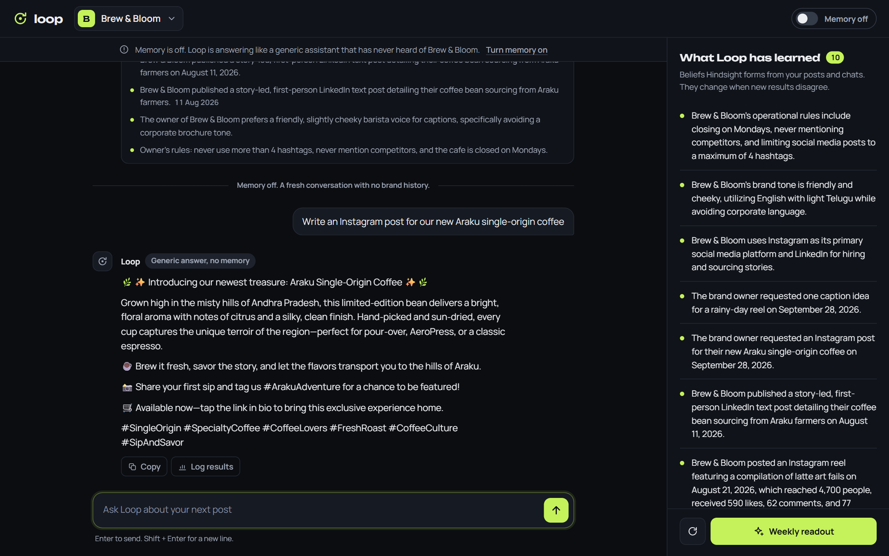
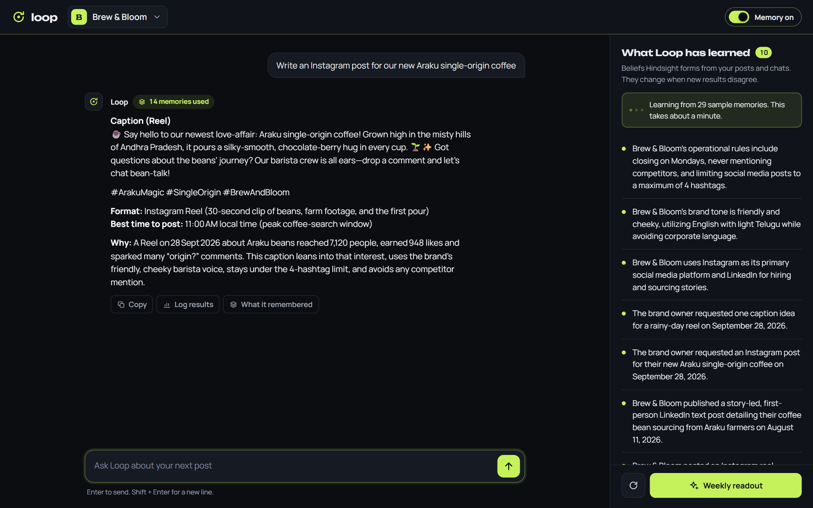
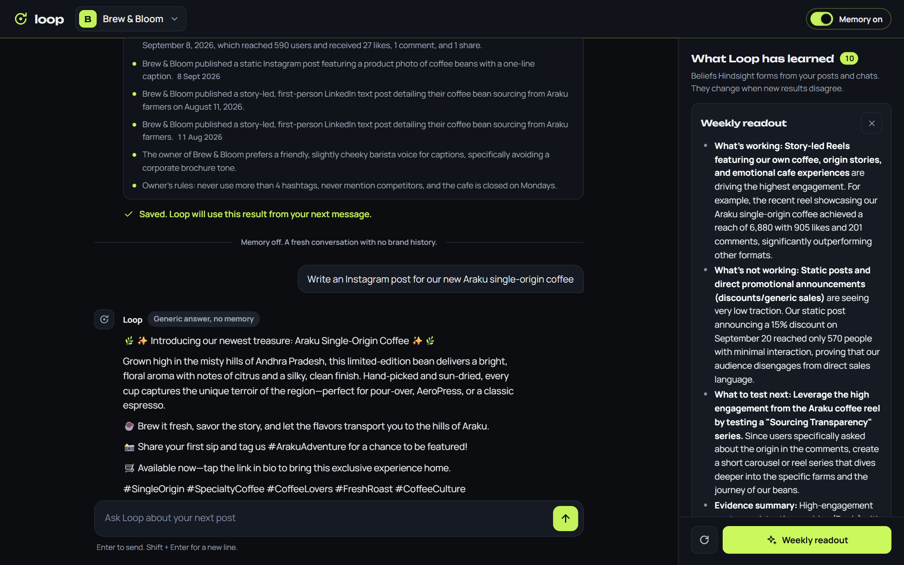

# My Hindsight agent started citing its own guesses as evidence

The answer looked great. Loop, the social media agent I built on [Hindsight agent memory](https://github.com/vectorize-io/hindsight), recommended a carousel at 10 AM for a café's new single-origin coffee, and it backed the plan with a confident justification: "We're using the carousel layout and 10 AM slot that were recommended in our Sep 28 2026 plan for the Araku coffee series."

The only plan from Sep 28 was one Loop had written itself, a few minutes earlier, with nothing useful in memory. The café's real history pointed the other way: its Friday-evening reels mostly reached 4,700 to 7,000 people, and its static posts never broke 900.

My agent had started agreeing with itself. This post covers how that happened, why it's an easy mistake with any long-term memory, and what the fix looks like in code.

## What Loop does

Loop is a strategist for one brand at a time. You describe the brand in a few taps: what you post about, where, how you sound, and any hard rules. Then you ask it things like "write an Instagram post for our new Araku coffee" or "why do my discount posts get so little reach?" When a post goes live, you log how it did: reach, likes, comments, shares, and a note such as "lots of comments asked where the beans are from."

The stack is deliberately small. A FastAPI app (`main.py`) serves a single-page UI, Groq handles generation (`openai/gpt-oss-120b`, with `qwen/qwen3-32b` as a fallback), and Hindsight holds everything the agent knows. Every brand gets its own memory bank, created with a short mission statement that tells Hindsight what the memory is for: learning which formats, topics, tones and posting times work for this audience, and updating beliefs when new results contradict old ones.

Every chat message runs the same three steps:

1. **Recall** what Hindsight knows that's relevant to the request.
2. **Generate** a reply grounded in those memories.
3. **Retain** something, so the next reply is better.

Post results go through `retain` too, with their real timestamps. Hindsight extracts facts from what it's given and consolidates them in the background into observations, beliefs like "reels featuring the café's craft drive the highest engagement." Those observations fill a "What Loop has learned" panel beside the chat, and `reflect` turns the whole history into a weekly readout. If you haven't used Hindsight's [retain, recall and reflect APIs](https://hindsight.vectorize.io/), that is the entire surface area. The rest of this post is about the places where it was easy to hold them wrong.



## The bug: step three stored the wrong thing

My first version of step three looked reasonable. It stored the exchange: `content=f"The user asked: {req.message}\nLoop replied: {reply[:600]}"`. Store the conversation and the agent remembers the conversation. That's what memory means, right?

Here's what actually happened. The first time I asked about the new coffee, recall came back empty (more on why in the lessons), so the model did what models do: it produced a plausible generic plan, a carousel at 10 AM. That reply went straight into memory. Hindsight did exactly its job. It extracted a clean, dated fact: "Loop created a carousel Instagram post for Araku coffee featuring farm, roasting, brewing, and tasting notes."

The next time I asked, recall surfaced that fact right next to the real post history. To a language model, a dated statement about a carousel plan for Araku coffee looks exactly like evidence, so it cited it. The memory layer wasn't wrong. I had fed it the agent's own speculation and filed it as experience.

I think this generalizes. Any agent that writes its outputs into the same store it reads evidence from will drift toward agreeing with itself. The first guess gets cited, the citation makes the second answer more confident, and the second answer gets stored too.

## The fix: retain inputs, not outputs

The fix was two changes. First, step three now stores only what the owner said:

```python
# RETAIN what the owner said (requests, preferences, feedback) in the background so the user
# isn't kept waiting. Loop's own reply is deliberately not stored: otherwise its past guesses
# come back later as "evidence" and the agent starts agreeing with itself.
if req.memory:
    hs_run(
        HS.retain,
        bank_id=bank,
        content=f"The brand owner told Loop: {req.message}",
        context="owner message in chat",
        retain_async=True,
    )
```

Owner messages are real signal: "we're launching Araku coffee," "never mention competitors," "stop using emojis." The agent's replies are hypotheses, and a hypothesis only becomes evidence after it has been tested. That's exactly what the "Log results" flow is for. A draft that gets posted and measured comes back as a result with numbers attached. A draft nobody posted shouldn't come back at all.

Second, the system prompt now says so explicitly, because older banks can still hold self-generated facts: "Measured post results and owner statements are evidence. Loop's own earlier drafts are NOT evidence: never justify a choice by saying you suggested it before."

`retain_async=True` turned out to be a nice side effect. Retention now happens in the background, so the user gets the reply without waiting on fact extraction.

## Recall: two queries, not one

The other half of grounding is what you ask memory for. A single recall on the user's message works for specific questions and fails for vague ones. "What should I post this weekend?" doesn't look anything like "the café is closed on Mondays" or "never use more than 4 hashtags," but both matter. So every chat runs two recalls and merges them:

```python
def recall_context(bank: str, message: str):
    """Two searches: the user's actual request + a standing 'what do we know' query."""
    queries = (message, "brand voice, owner rules, audience preferences, best and worst performing posts and timing")
    seen, merged = set(), []
    for q in queries:
        for m in recall_texts(bank, q):
            if m["text"] not in seen:
                seen.add(m["text"])
                merged.append(m)
    return merged[:14]
```

The standing query is boring on purpose. It's the "things you must never forget about this brand" query, and it means the owner's rules land in context even when the question doesn't mention them.

## What it looks like now

To make the effect of memory visible, the UI has a Memory switch. Off means no recall and no retain: the model gets a generic system prompt and its own separate conversation history. That separate history was its own bug. My first version shared one history across both modes, which quietly leaked brand details into the "generic" answers and made the comparison meaningless.

To test Loop, I seeded a bank with 24 posts of history for a café brand, plus five owner rules. Then I asked the same question in both modes: "Write an Instagram post for our new Araku single-origin coffee."

With memory off, Loop wrote a competent caption for a generic coffee brand and finished with eight hashtags: `#ArakuCoffee #SingleOrigin #SpecialtyCoffee #CoffeeLovers #FreshRoast #FromFarmToCup #MorningBoost #CoffeeCulture`. The owner's very first rule is "never more than 4 hashtags."



With memory on, it suggested a 15-second reel of the first pour, and its "Why" line used numbers it hadn't invented: "The Sep 25 Reel of the first Araku pour pulled 6,880 reach, 905 likes, 184 comments, and 132 shares—our strongest recent performance, so we'll replicate that format and timing while staying under the 4-hashtag limit."



Then the loop closed. I logged a result for that reel: 7,120 reach, 948 likes, 201 comments, and a note that lots of commenters asked where the beans came from. In a later session, with a fresh page and an empty chat history, the new draft invited followers to ask about the beans' journey, and its "Why" line cited the new result: "A Reel on 28 Sept 2026 about Araku beans reached 7,120 people, earned 948 likes and sparked many 'origin?' comments."

The weekly readout, written by `reflect`, turned that one note into a recommendation: test a post "dedicated exclusively to the 'story behind the bean'". It also flagged the 15%-off announcement that reached 570 people as the thing that wasn't working.



None of that lives in the prompt or the chat history. It lives in the bank.

## Lessons

**1. Retain inputs and measured outcomes, never raw outputs.** If your agent writes into the store it reads evidence from, it will eventually cite itself. Outputs should earn their way into memory by being tested.

**2. Give every memory a stable identity.** Sample posts and the brand profile use fixed document IDs, so saving a profile twice replaces it instead of stacking two contradictory versions. Hindsight enforces this for async batches: it rejects a batch whose items share a document ID, which is how I found out my seeding code was wrong. Each item now carries its own ID and its real timestamp:

```python
{"content": _post_sentence(p), "context": "post performance",
 "timestamp": _post_time(p).isoformat(), "document_id": f"sample-post-{i:02d}"}
```

**3. Timestamp everything that happened at a specific time.** "What's working lately?" is a temporal question. Results carry their real posting time through `timestamp=`, so memory can tell an August post from one logged yesterday. The readout's talk of "the latest reel" depends on it.

**4. Know your client's concurrency model.** Remember the empty recall that started all this? The Python client I used wraps async calls in a sync API, and its HTTP session is tied to the event loop of the first thread that uses it. FastAPI runs sync routes on a thread pool, so calls began failing at random with "Timeout context manager should be used inside a task." It looked like flaky memory, but it was a threading problem on my side. The smallest fix was one worker thread that owns every Hindsight call:

```python
_hs_thread = ThreadPoolExecutor(max_workers=1, thread_name_prefix="hindsight")

def hs_run(fn, **kwargs):
    return _hs_thread.submit(fn, **kwargs).result()
```

The cleaner long-term version is async routes calling the client's async methods directly. The single thread was the smallest change that made recall reliable.

**5. Show the memory.** The "What Loop has learned" panel and the "What it remembered" button did more for trust than any prompt tweak. When an answer cites a number, you can open the exact memories it came from. When something's wrong, you can see why. That's how I spotted my own agent's carousel plan sitting in its recall results, dressed up as history.

## Closing

The model didn't get smarter between the eight-hashtag answer and the one that cited a real reel. What changed was what it was allowed to remember, and what I stopped letting it remember. If you're adding long-term memory to an agent, it's worth reading up on [what agent memory is and how it differs from stuffing context](https://vectorize.io/what-is-agent-memory) before you decide what to write into it. In Loop, the most important line of code is the one that doesn't retain the reply.
